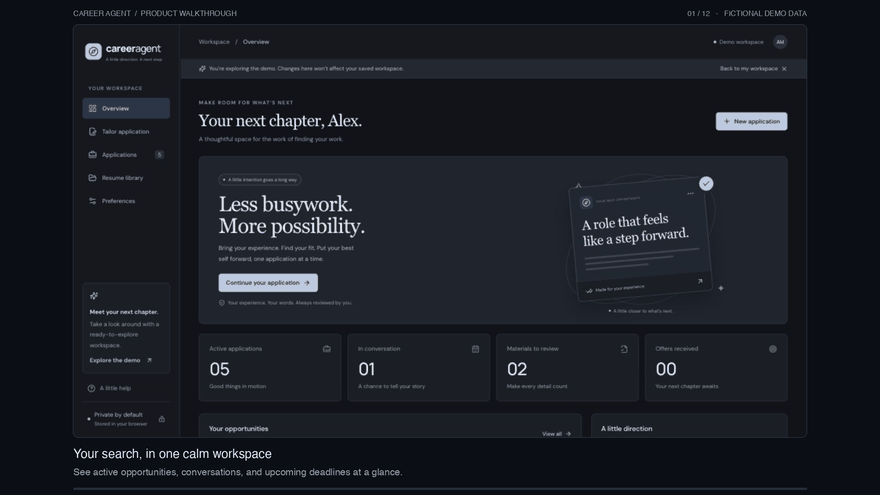

# Career Agent

**A little direction. A next step.**

A local-first workspace for comparing your experience with a job description, tailoring application materials, and keeping every opportunity moving. Built with React, TypeScript, and Vite, with a cool dark interface that works on desktop and mobile.

[](https://github.com/Lilllllly06/agentic-job-application/actions/workflows/ci.yml)

[](docs/demo/career-agent-demo.mp4)

[Watch the full walkthrough — MP4, 1 minute](docs/demo/career-agent-demo.mp4) · [Captions](docs/demo/career-agent-demo.vtt) · [Screenshots and demo notes](docs/demo/README.md)

The walkthrough uses a fictional candidate and illustrative opportunities in the isolated demo workspace.

## What you can do

| Workspace              | What it does                                                                                                                  |
| ---------------------- | ----------------------------------------------------------------------------------------------------------------------------- |
| **Overview**           | See active applications, interviews, materials to review, offers, recent roles, and upcoming deadlines.                       |
| **Tailor application** | Add a job description and profile, compare skills and keywords, and create editable resume and cover-letter drafts.           |
| **Applications**       | Search, filter, and sort opportunities; update status, deadlines, contacts, next steps, and notes; export CSV.                |
| **Resume library**     | Import `.tex` or `.txt` resumes, review extracted text, save named versions, and keep evidence connected to its source.       |
| **Preferences**        | Save target roles and locations, set a shortlist threshold, open a LinkedIn search, and export or restore a workspace backup. |

Working drafts and saved application packages persist in browser storage. Removing an application, resume version, or evidence item offers an undo action. Demo changes stay separate from your real workspace and disappear on refresh.

## Try the workflow

1. **Start with your experience.** Import a `.tex` or `.txt` resume, load a saved version, or paste your original experience into a profile.
2. **Bring an opportunity.** Add the company, role, and job description. A posting link, contact, deadline, and notes are optional.
3. **Compare your fit.** Review detected skills, missing evidence, and relevant keywords before creating drafts.
4. **Make the materials yours.** Edit the resume and cover letter, use the outreach note and interview prompts, and review each claim.
5. **Approve and track.** Approve the exact package, save it with the opportunity, and apply on the company's own website when ready.

Use **Explore the demo** to try the workspace without adding personal information.

## How analysis and approval work

Analysis runs locally using a deterministic collection of skill patterns and keyword matches. With recognized job skills, the score combines **75% skill coverage and 25% keyword coverage**. When no skills are recognized, it uses keyword coverage alone. An empty profile or job description receives no score.

The score measures text overlap; it is not a prediction of hiring success. Keywords and skill mentions still need review in context.

Resume drafts select and rank sentences from the original profile. Cover letters use those source details and editable template text. The app does not invent education, employers, dates, metrics, or an applicant name. Supply your name and education explicitly if you want them included.

Approval is tied to the company, role, posting URL, source profile, job description, candidate details, and edited materials. Changing those inputs requires a new review. Saving a package stores a snapshot with the opportunity; saving the same role again updates that record rather than creating a duplicate.

**This version does not use a language model, run scheduled searches, scrape job boards, fill external forms, or submit applications.** Search preferences guide your manual workflow; they do not enable an unattended agent.

## Run locally

Use Node.js **22.12 or newer** and npm. Node 22 is used in CI.

```bash
git clone https://github.com/Lilllllly06/agentic-job-application.git
cd agentic-job-application
npm ci
npm run dev
```

Open the local URL printed by Vite. No account, API key, or backend setup is needed.

```bash
npm test          # Regression tests for analysis, storage, approvals, imports, and CSV
npm run build     # TypeScript check and production bundle
npm run preview   # Serve the production bundle locally
```

GitHub Actions runs the tests and production build for pull requests and pushes to `main` and `codex/**` branches.

## Files, exports, and privacy

- Resume imports accept `.tex` and `.txt` files up to **2 MB**. Review extracted LaTeX text before using it; PDF and Word import are not available yet.
- Resume and cover-letter drafts can be copied or downloaded as text. **Print / save PDF** opens the browser print flow for the current materials; review pagination before exporting.
- The application tracker exports CSV. **Preferences → Export backup** saves a JSON copy of applications, draft materials, resume versions, evidence, and preferences.
- **Restore backup** validates the file before replacing the workspace and offers a current-workspace backup first. Keep exported backups private.
- Application and resume content is stored in this browser's `localStorage`; it is not uploaded to an application server. Clearing site data or moving to a different browser does not carry it over. Export a backup before clearing data or switching devices.
- The interface loads Google Fonts, with system-font fallbacks. Fonts are separate from resume and application content.
- Git ignores private resume paths and local secrets, including `private/`, `resumes/private/`, `.env`, `resume.tex`, `*.private.tex`, and `*.resume.tex`. Do not commit your real resume or exported workspace backup.

Existing resume, application, evidence, and preference data from the earlier workspace format is migrated when available. The earlier global approval flag is not carried over to an unrelated package.

## Project structure

```text
src/
  App.tsx                 Workspace views and application workflows
  components/ui.tsx       Shared controls, tables, dialogs, and feedback
  data/sample.ts          Fictional demo profile and opportunities
  lib/analyzer.ts         Skill matching, scoring, and source-based drafts
  lib/latex.ts            Browser-side LaTeX extraction
  lib/workspace.ts        Data models, storage migration, approval, and exports
  styles.css              Dark theme tokens and responsive layouts
tests/lib.test.mjs         Regression tests
public/favicon.svg        Compass brand mark
docs/demo/                Walkthrough video, captions, screenshots, and source frames
scripts/render-demo.py    Optional demo renderer; not needed to run the app
```

## Next steps

- PDF resume parsing with an extracted-text review step.
- Optional language-model assistance with explicit review of generated claims.
- Job-board ingestion and saved search results.
- Optional authentication and synchronized storage across devices.

These are planned additions, not connected services in the current app.
