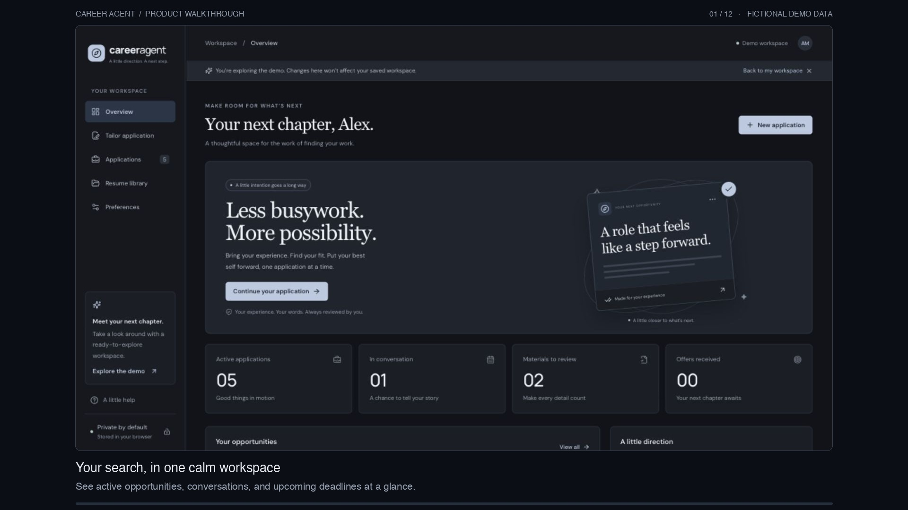
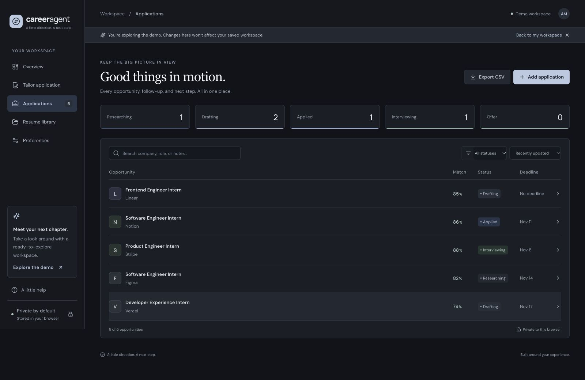

# Career Agent demo

A captioned, one-minute product walkthrough of the approved cool dark interface, compass logo, and document-and-pen tailoring icon.

[](career-agent-demo.mp4)

[Watch or download the MP4](career-agent-demo.mp4) · [WebVTT captions](career-agent-demo.vtt) · [Animated preview](preview.gif)

The video is an edited walkthrough assembled from actual app screenshots, with chapter captions and transitions. It is silent, with captions burned into the picture and a separate WebVTT file. The source screens were captured at 1600 × 900; the video is 1920 × 1080 at 24 fps.

All captures use the app's isolated demo workspace with the fictional candidate **Alex Morgan**. Company names and roles are illustrative; they do not represent verified current openings. No personal resume, credentials, form submission, or external service connection is shown.

## Chapters

| Time  | Workflow                                        |
| ----- | ----------------------------------------------- |
| 00:00 | Career Agent introduction                       |
| 00:03 | Overview and application momentum               |
| 00:08 | Resume library and working profile              |
| 00:13 | Job description and original experience         |
| 00:19 | Fit analysis, skill coverage, and keyword gaps  |
| 00:25 | Editable resume and cover-letter drafts         |
| 00:31 | Approval of the exact package                   |
| 00:34 | Editing the resume resets approval              |
| 00:39 | Saving the reviewed package to the tracker      |
| 00:43 | Searching opportunities                         |
| 00:47 | Status updates and saved package details        |
| 00:52 | Preferences, private backups, and manual search |
| 00:57 | Updated overview                                |

## Screenshots

[Overview](overview.jpg) · [Fit analysis](fit-analysis.jpg) · [Application materials](materials.jpg) · [Tracker](tracker.jpg) · [Mobile layout](mobile.jpg) · [All video scenes](contact-sheet.jpg)



## Regenerate the video

Running the app requires only Node and npm. The following optional Python 3.11+ dependencies are for media authoring:

```bash
python3 -m venv /tmp/career-agent-demo-env
/tmp/career-agent-demo-env/bin/python -m pip install -r scripts/requirements-demo.txt
/tmp/career-agent-demo-env/bin/python scripts/render-demo.py
```

Run these commands from the repository root. The renderer reads `docs/demo/storyboard.json` and the committed screenshots in `docs/demo/frames/`, then writes the MP4, WebVTT captions, GIF, poster, and contact sheet to `docs/demo/`. Use `--output /absolute/path` for a different output folder. It uses macOS, Linux, or Windows system fonts when available, with a fallback otherwise.

To refresh the source captures after UI changes, start the app, choose **Explore the demo**, set the browser content viewport to **1600 × 900**, and capture each scene in storyboard order. Keep the same filenames. The review sequence is deliberate: generate materials, approve, edit the resume, approve again, save to the tracker, search for Linear, then update its status to Interviewing. Dismiss transient notifications before capturing.

Never use a real saved workspace for public demo captures. The renderer only reads the committed screenshots; it does not access browser storage or application data.
